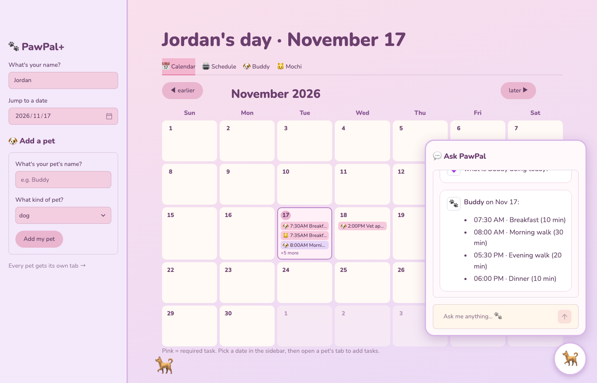
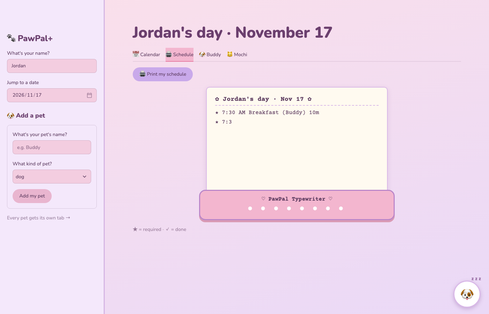
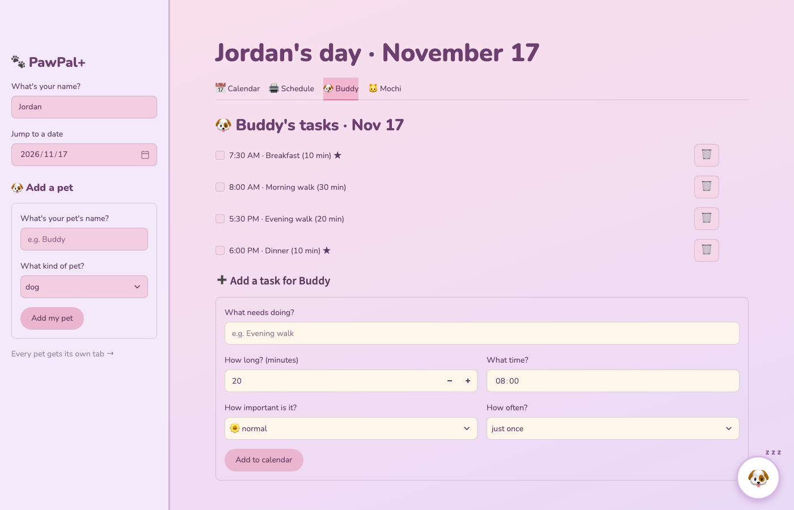
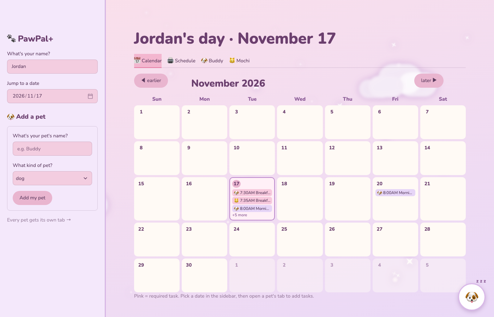
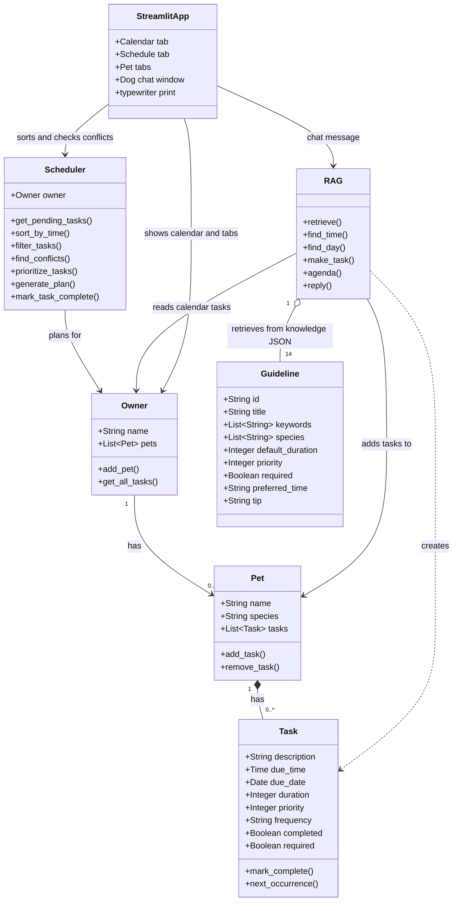

# 🐾 PawPal+ ♡ your cozy pet-care buddy

| Calendar + the dog's chat | Typewriter schedule | A pet's own tab | Cute-style sky |
|---|---|---|---|
|  |  |  |  |

**PawPal+ is a pet-care planner you can talk to.** Chat with the sleepy dog in the corner: it adds pets, puts tasks on a calendar, tells you what each pet is doing today, and answers care questions, using **RAG** (it *retrieves* care guidelines and your own calendar before it answers). Your day then prints on a little typewriter.

**Why it matters:** pet care is lots of small, easy-to-forget jobs (meals, meds, walks, vet visits). PawPal turns one plain sentence into scheduled tasks, fills in sensible durations and times from care guidelines, and keeps same-time tasks apart, so nothing gets missed.

## 🌱 Base project
**PawPal+** was a Streamlit app built with Python classes (`Owner → Pet → Task` plus a `Scheduler`). It let you add pets and tasks, sort them by time, spot same-time conflicts, repeat daily/weekly tasks, and build a plan that fits your free time. All of that is still here and still tested.

**What the final project adds:**
- 💬 **AI chat (RAG)** that reads care guidelines *and* your calendar
- 🐕 **Add pets by chatting**: "add a dog named Buddy and put him on the schedule for a walk on nov 20th at 8am"
- 📅 **Calendar tab** (month view), 🐾 **a tab per pet**, 🖨 **typewriter schedule**
- 🐶 **Sleeping dog in the corner**: tap it, the chat opens, the dog walks around
- ✨ **Cute-style sky**: twinkling stars, light motes, clouds, all drawn in CSS (no emojis)

## 🧠 Architecture overview
Source: [`diagrams/architecture.mmd`](diagrams/architecture.mmd). Paste it into [mermaid.live](https://mermaid.live) to view.



**How data flows**, input → process → output:
1. **Input:** you type a message in the dog's chat window (`app.py`).
2. **Retrieve:** `rag.py` looks things up in two places: the 14 care guidelines in `knowledge/care_guidelines.json` (filtered to your pet's species) and the tasks already on your calendar.
3. **Generate:** the reply, or the new tasks, are *built from what was retrieved* (tip, duration, usual time, today's task list). New tasks that would land on the same minute are nudged 5 minutes apart.
4. **Output:** tasks appear on the calendar and in the pet's tab, and the typewriter prints the schedule.
5. **Human in the loop:** you read the reply, see exactly what was added, and can tick off or 🗑 delete any task. Nothing is hidden.
6. **Testing:** `pytest` (25 tests) checks the `Scheduler` and the RAG chat.

## 🚀 Setup instructions
```bash
# 1. Clone Repo

# 2. make and activate a virtual environment
python -m venv .venv
source .venv/bin/activate          # Windows: .venv\Scripts\activate

# 3. install (streamlit + pytest)
pip install -r requirements.txt

# 4. run the app, it opens in your browser
streamlit run app.py
```
 Then: pick a date → add a pet in the sidebar (or just tap the sleeping dog and chat) → open the **🖨 Schedule** tab and press **Print**.

Optional: `pytest` runs the tests, and `python demo.py` prints the sample chat below.

## 💬 Sample interactions
Real, unedited output of `python demo.py` (re-run it to reproduce):

```text
You:    add a dog named Buddy and put him on the schedule for a walk on nov 20th at 8am
PawPal: Added **Buddy** (dog) to your pets. They have their own tab now 🐾

Added **Morning walk** for Buddy on Nov 20 at 08:00 AM (30 min) 📅

You:    add a cat named Mochi
PawPal: Added **Mochi** (cat) to your pets. They have their own tab now 🐾

Want a routine for them? Say “build a routine for Mochi”.

You:    build a routine for Mochi on nov 18
PawPal: Done! I looked up care guidelines for Mochi and added 4 tasks to Nov 18. Open the **🖨 Schedule** tab to watch the typewriter ✨

You:    what is Buddy doing on nov 20?
PawPal: **Buddy** on Nov 20:
- 08:00 AM · Morning walk (30 min)

You:    what should I feed my cat?
PawPal: **Mochi · Breakfast:** Cats usually prefer 2-3 small meals; always leave fresh water out. (about 5 min, around 07:30 AM)

**Mochi · Dinner:** Wet food should not sit out longer than about 30 minutes. (about 5 min, around 06:00 PM)

You:    quantum physics
PawPal: Hmm, I don't know about that yet. Try asking what a pet is doing today, or about feeding, walks, play, medication, grooming, litter or vet visits 💜
```

**How RAG shows up in these examples:**
- The walk's **30 minutes** was never typed. It was *retrieved* from the dog-walk guideline.
- Mochi's routine (**4 tasks**: breakfast, litter box, play, dinner) came from the cat guidelines. Dogs don't get a litter box.
- "What is Buddy doing" is answered from the **calendar**, not from a fixed script.
- With no matching guideline, it says "I don't know" instead of making something up.

## 🤔 Design decisions
| Decision | Why | Trade-off |
|---|---|---|
| **Keyword retrieval, no language model** | Free, offline, predictable, easy to explain and test. | It only knows 14 topics and can't understand unusual wording. |
| **Retrieve from the calendar too, not just guidelines** | So the chat can answer "what is Buddy doing today?" from real data. | Slightly more code in `rag.py`. |
| **Reuse the original `Scheduler`** | It already sorted tasks and found conflicts, and was tested. | Its conflict check only catches same-start-time tasks, not overlapping durations. |
| **Chat edits your data directly, but visibly** | Fast and simple; every change is shown in the reply and can be deleted in the pet's tab. | No "are you sure?" step. |
| **Plain CSS for the look** (typewriter, dog, sparkles) | No extra libraries, easy to read. | Streamlit overrides some styling, so a few details are approximations. |
| **Kept it small** (one helper file, one stylesheet, one app) | It's a beginner class: fewer files, fewer things to break. | Fewer features than a full planner (no multi-day optimizer). |

## 🧪 Testing summary
**25 / 25 tests pass.** 10 are the original PawPal tests (sorting, recurring tasks, conflicts) and 15 are new for the chat: right species, knows what each pet is doing, adds tasks on the right date, adds new pets, no schedule conflicts, no duplicates, handles empty input / no pets / unknown topics.

Reproduce with `pytest -v`. Real output:

```text
================================== test session starts   ===================================
platform darwin -- Python 3.13.15, pytest-9.2.0, pluggy-1.7.0
rootdir: /Users/nellie/Desktop/cd applied-ai-system-final/ai110-module2show-pawpal-starter
configfile: pytest.ini
testpaths: tests
plugins: anyio-4.16.0
collected 25 items                                                                       

tests/test_pawpal.py ..........                                                    [ 40%]
tests/test_rag.py ...............                                                  [100%]

=================================== 25 passed in 0.03s ===================================
```

**What worked:** tests caught real bugs early. The date "nov 20th" didn't parse at first, and a test about "today" showed the chat uses the real today, not the calendar's selected date.
**What didn't / limits:** the chat only knows 14 topics, and the tests cover the logic, not how the page looks. 
**What I learned:** testing the boring cases (empty input, no pets, unknown topic) matters as much as testing the happy path.

## 💭 Reflection
This project taught me that the AI part of an app doesn't have to be a giant model. A small retrieve → answer loop, built on data the app already has, can feel smart *and* be easy to test and trust. It also taught me to make things smaller when they get too complicated: my first version was much bigger, and cutting it down made it work better. The full responsible-AI reflection (limitations and bias, misuse, surprises, and how I worked with AI) is in [`model_card.md`](model_card.md).

## 📁 Files
| File | What it is |
|---|---|
| `app.py` | the Streamlit app (tabs, calendar, dog chat) |
| `rag.py` | retrieve + generate (the AI chat) |
| `style.css` | colors, calendar, typewriter, dog + sparkle sky |
| `knowledge/care_guidelines.json` | the care guidelines the chat retrieves from |
| `pawpal_system.py` | original classes (Owner, Pet, Task, Scheduler) |
| `demo.py` | prints the sample chat above |
| `tests/` | original tests + chat tests |
| `diagrams/` | `architecture.mmd` (final) + original UML diagrams |
| `assets/` | screenshots |
